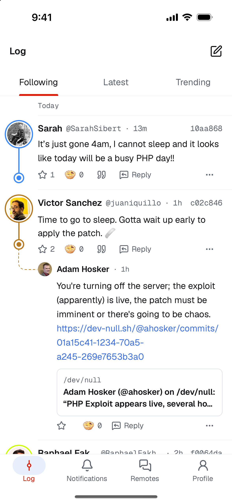
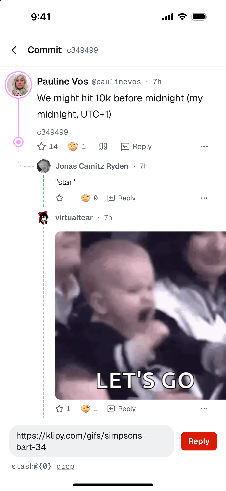
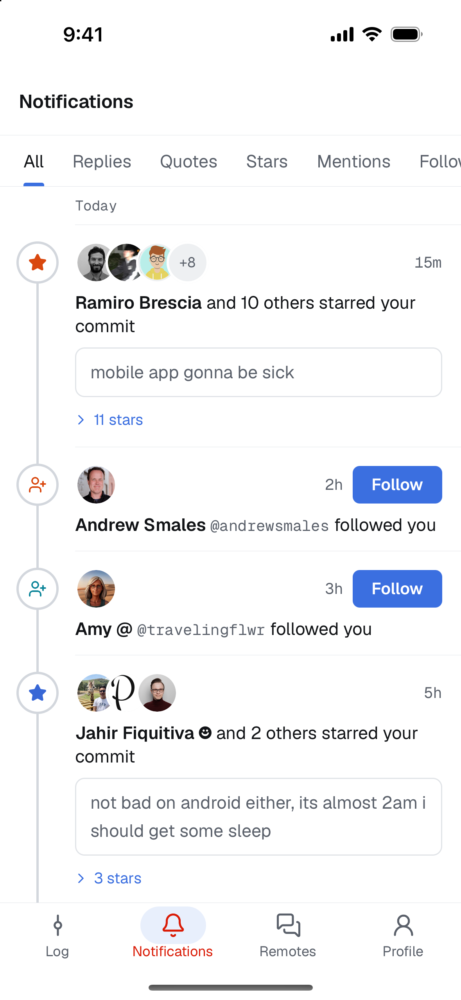
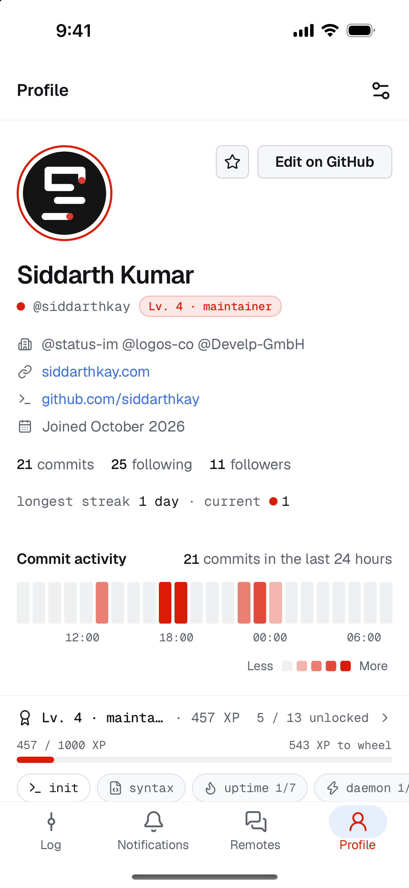
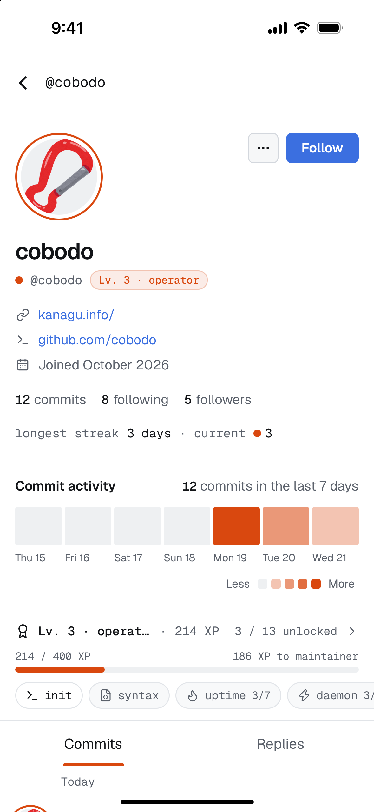
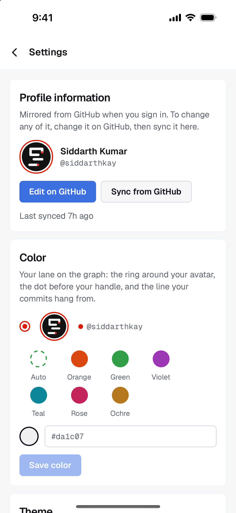
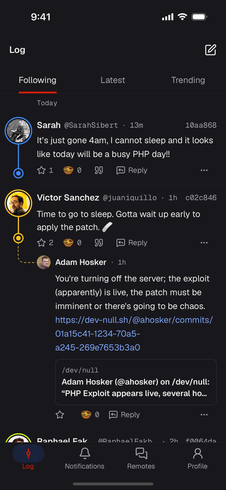
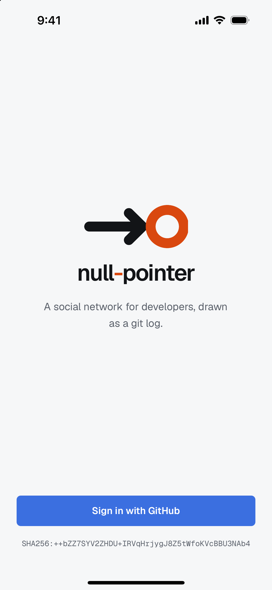

<p align="center">
  
</p>

<h1 align="center">null-pointer</h1>

<p align="center">
  
  
  
</p>

A native iOS and Android client for [devnull](https://dev-null.sh), the social network for developers drawn as a git log. Built with Expo and React Native.

null-pointer is an independent client and is not affiliated with devnull. The devnull name and mark belong to devnull. The idea of a mobile client came from [simonhamp/devnull-mobile](https://github.com/simonhamp/devnull-mobile); this app is a separate codebase.

<p align="center">
  
  
  
  
</p>
<p align="center">
  
  
  
  
</p>

## Signing in

There are no passwords or tokens. On first launch the app generates an ed25519 SSH key and stores the seed in the Keychain (iOS) or Keystore-backed storage (Android). Every API request is signed with it in the OpenSSH `ssh-keygen -Y sign` format under the `devnull-api` namespace.

"Sign in with GitHub" opens dev-null.sh in the system browser. devnull approves the phone's key and redirects to `devnull://auth/callback` with a code, which the app exchanges for the account using PKCE.

## Development

```sh
npm install
cp .env.example .env
npx expo prebuild
npx expo run:ios   # or: npx expo run:android
```

`EXPO_PUBLIC_DEVNULL_URL` in `.env` selects the devnull instance (defaults to production).

`ios/` and `android/` are generated by `expo prebuild` and not committed. Native configuration lives in `app.json`, `app.config.js` and `plugins/`.

```sh
npx expo lint
npx tsc --noEmit
npm test   # the signing test needs ssh-keygen on PATH
```

## CI

| Workflow | Trigger | Output |
| --- | --- | --- |
| `pr.yml` | pull request to `main` | lint, typecheck, tests, Android APK + AAB, iOS IPA as artifacts |
| `main.yml` | push to `main` | same |
| `release.yml` | tag `v*` | same, stamped with the tag version, plus a GitHub release and a TestFlight upload |

All three call `build.yml`. Jobs run on self-hosted runners (`bladerunner-linux`, `bladerunner-macos`). 

 **F-Droid**: built from source by F-Droid's bot from `v*` tags, via `metadata/com.siddarthkay.nullpointer.yml` in [fdroiddata](https://gitlab.com/fdroid/fdroiddata).

## Security

- Only the 32-byte key seed is stored, in the Keychain or Keystore, readable after first unlock only.
- Sign-in is OAuth authorization code with PKCE and a `state` check.
- Android backups are off (`allowBackup: false`).
- Links from commits and profiles open only `http` and `https` URLs, in the in-app browser.
- App Transport Security is at its default: HTTPS only.

## License

[Mozilla Public License 2.0](LICENSE). Geist and Geist Mono are under the [SIL Open Font License](assets/fonts/OFL.txt).
